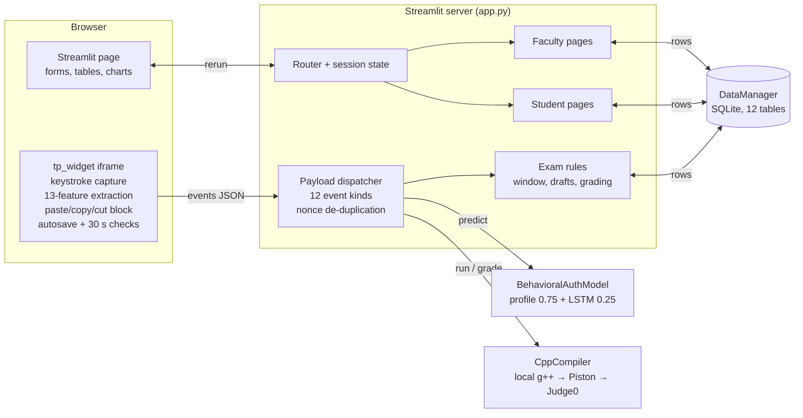
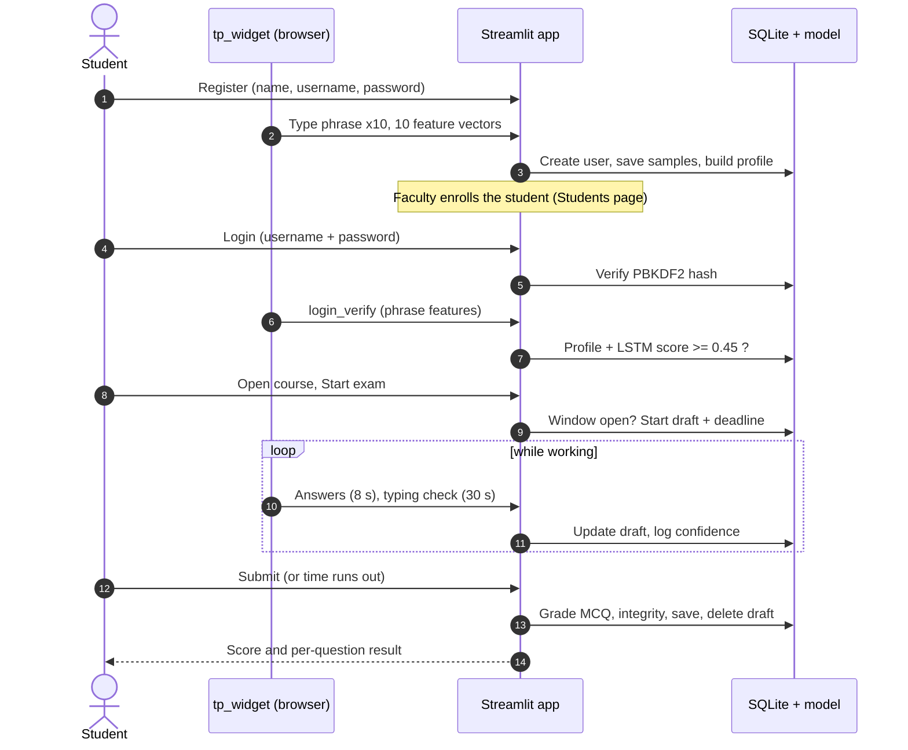
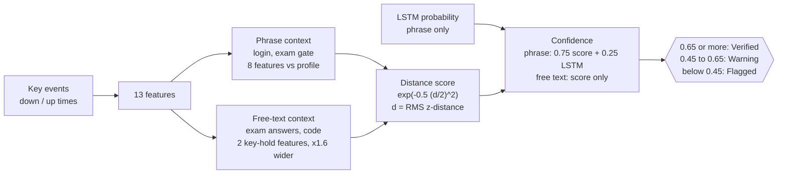
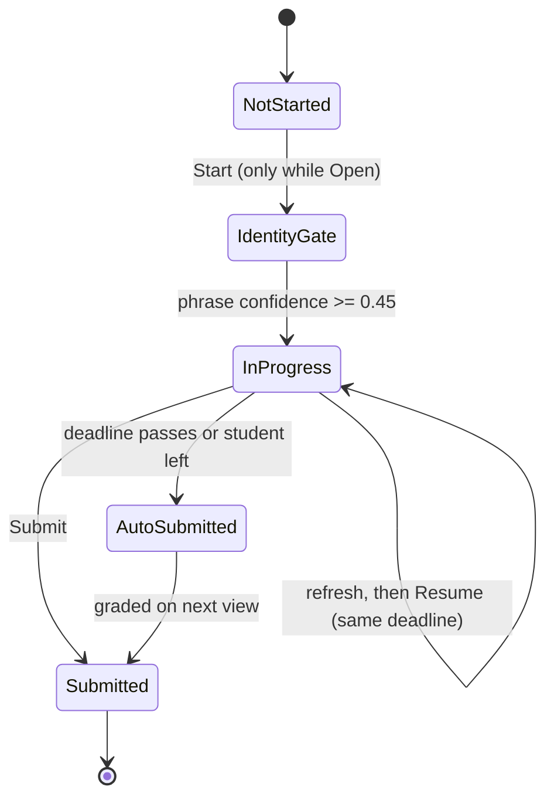
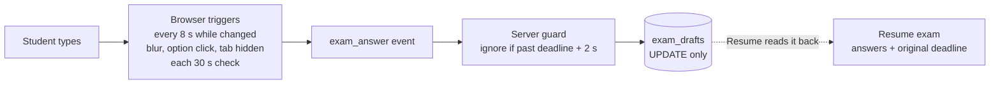
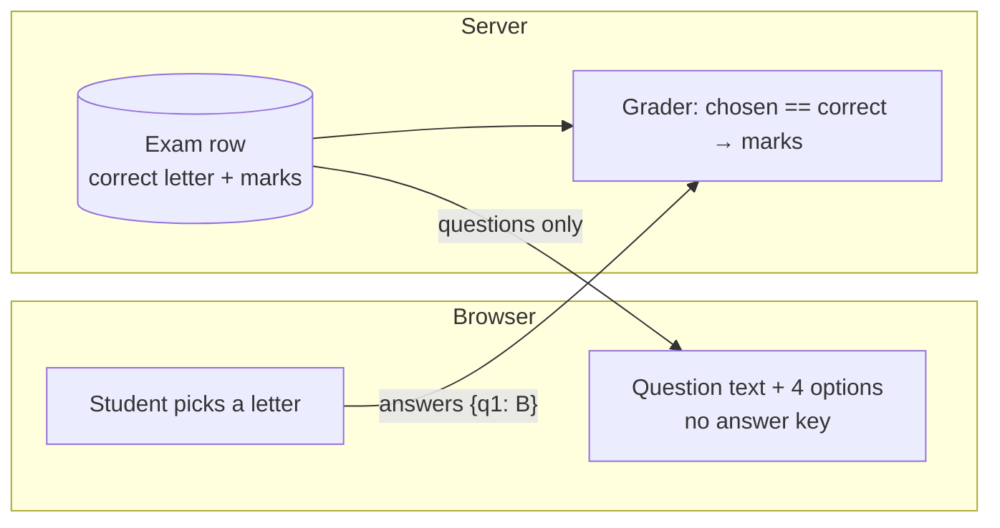
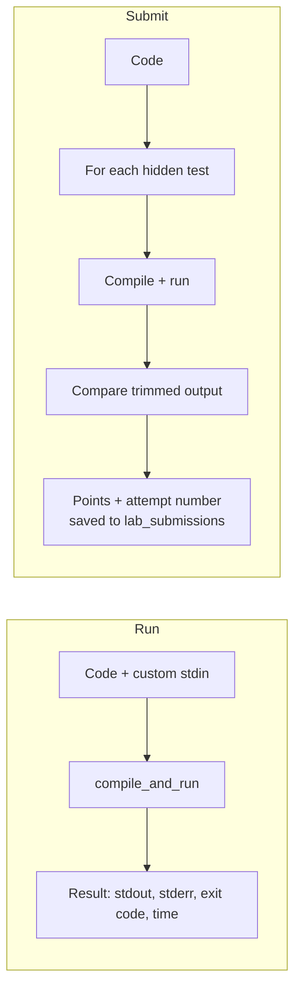
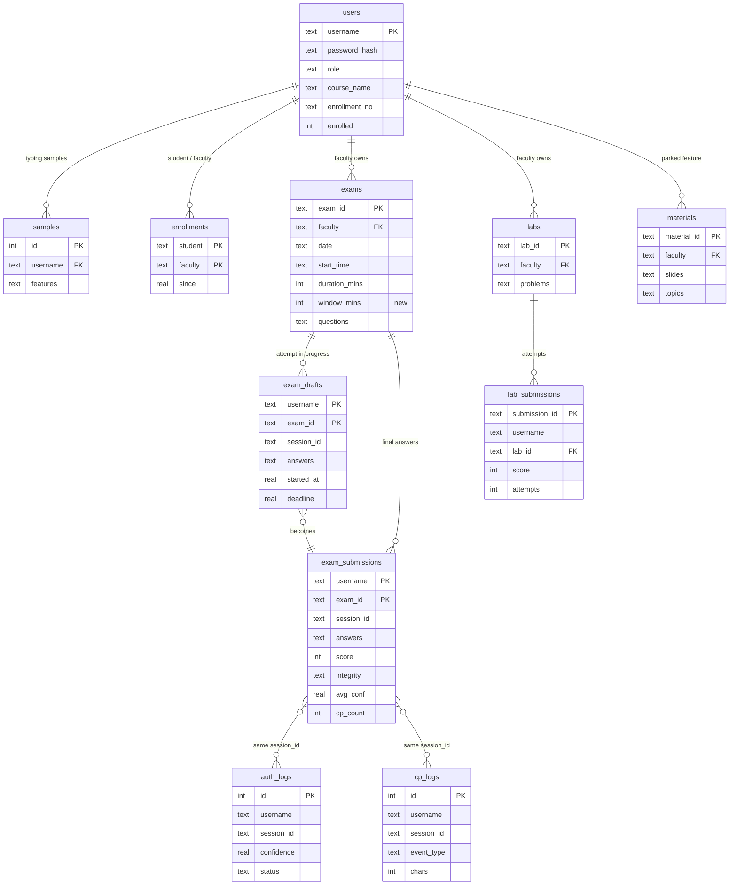

# TrueTestAuth

TrueTestAuth is a Streamlit-based assessment platform that checks the person taking an online exam is the person who enrolled, using **keystroke dynamics** (typing rhythm). It combines **behavioral authentication**, **continuous identity verification**, **timed MCQ and descriptive exams**, and an **auto-graded C++ coding lab** for faculty and students.

Faculty build exams, enroll students and review scores with typing-confidence history. Students type a phrase to enroll their rhythm, are re-checked at login, at the exam gate and every 30 seconds while they work, and see their score as soon as they submit.

> Status: a working academic prototype. Section [Limitations](#limitations) lists what is fixed and what is still open.

---

## Contents

1. [At a glance](#at-a-glance)
2. [Key features](#key-features)
3. [Tech stack](#tech-stack)
4. [System architecture](#system-architecture)
5. [Roles and pages](#roles-and-pages)
6. [Student journey](#student-journey)
7. [Behavioral authentication](#behavioral-authentication)
8. [Exam lifecycle](#exam-lifecycle)
9. [Grading and integrity](#grading-and-integrity)
10. [C++ coding labs](#c-coding-labs)
11. [Data model](#data-model)
12. [Evidence: benchmark results](#evidence-benchmark-results)
13. [Installation and setup](#installation-and-setup)
14. [Demo environment](#demo-environment)
15. [Security considerations](#security-considerations)
16. [Verification](#verification)
17. [Limitations](#limitations)
18. [Roadmap and future scope](#roadmap-and-future-scope)
19. [Release history](#release-history)
20. [Project structure and important files](#project-structure-and-important-files)

---

## At a glance

| | |
| --- | --- |
| Roles | Faculty, Student |
| Database | One SQLite file, 12 tables |
| Code | about 5,200 lines of Python, about 1,000 lines of browser code (non-blank) |
| Typing features | 13 per sample |
| Exam types | MCQ (auto-graded) and descriptive (stored for manual marking) |
| Labs | C++17, hidden tests, per-test points |
| Benchmark | 8 methods on the CMU keystroke dataset (51 typists) in [`experiments/`](experiments/) |

**Project level.** A capstone-grade prototype: broad and working end to end, with a real benchmark behind the authentication idea. It is not production-ready because the anti-cheating rules run in the browser, student code is not sandboxed, and no automated tests are committed.

| Area | Level (5 = production) | Why |
| --- | :---: | --- |
| Feature breadth | 4 | Two roles, exams, labs, enrollment, reports |
| Authentication idea and evidence | 3 | Real benchmark; demo training data is synthetic |
| Data and persistence | 4 | Transactions, one-time migration, saved drafts |
| Security hardening | 2 | Browser-side rules, unsandboxed code, unescaped HTML |
| Automated tests | 1 | None committed |
| Deployability | 2 | One machine, server-local clock, Streamlit session state |

These ratings are a judgement from reading the code.

---

## Key features

- **Two roles** with separate workflows. Faculty choose which registered students join their course.
- **Behavioral enrollment and authentication.** Students type a fixed phrase 10 times at registration; a per-user profile is built from the 13 typing features.
- **Continuous verification** during exams and labs, with a confidence status (Verified, Warning, Flagged) logged each time.
- **Copy, paste, cut, context-menu and drag-and-drop blocking** in the assessment editors; paste attempts are logged.
- **Exam window.** Each exam opens at its date and start time and stays open for a window; faculty can reschedule it at any time.
- **Saved answers and Resume.** Answers are stored as drafts while students work. A refresh or crash shows **Resume** with the original deadline, and attempts whose time ran out are submitted and graded automatically.
- **MCQ auto-grading** against the faculty's answer key, with scores shown to students (per-question right or wrong) and to faculty (score out of total, chosen vs correct).
- **C++ coding labs** with sample and hidden tests, per-test points, run and submit, and submission history.
- **PDF question-paper text extraction** with `pdfplumber`.
- **Faculty reports.** Confidence statistics, flag counts, timelines, per-exam summary, integrity grade, CSV export.
- **Local SQLite persistence** and TensorFlow/Keras model persistence.

---

## Tech stack

| Layer | Technology |
| --- | --- |
| Application | Python 3.11, Streamlit, Pandas, NumPy, Requests, python-dotenv, pdfplumber |
| Machine learning | TensorFlow CPU, Keras LSTM, manual z-score normalization |
| Frontend | HTML, CSS, JavaScript, Streamlit custom component protocol |
| C++ execution | Local `g++` or `clang++`, Piston API, Judge0 API |
| Persistence | SQLite (`data/truetestauth.db`) through Python's built-in `sqlite3` |

---

## System architecture

The browser runs one custom Streamlit component (`frontend/index.html`) that captures keystrokes and sends JSON events. Every event passes through a single dispatcher in `app.py`, which drops duplicates by nonce and routes the event. Three modules do the real work: `DataManager` (database), `BehavioralAuthModel` (scoring) and `CppCompiler` (code execution).



### Modules

| File | Lines | Responsibility |
| --- | ---: | --- |
| [`app.py`](app.py) | 2,643 | All pages, session state, event dispatcher, exam rules, grading |
| [`data_manager.py`](data_manager.py) | 1,068 | SQLite schema, every query, password hashing, exam window rules |
| [`frontend/index.html`](frontend/index.html) | 982 | Browser component: capture, paste block, autosave, lab editor |
| [`ui_components.py`](ui_components.py) | 551 | Reusable UI helpers; only the student navbar is still used |
| [`compiler.py`](compiler.py) | 368 | C++ execution through three engines, hidden-test grading |
| [`ml_model.py`](ml_model.py) | 336 | Feature extraction, per-user profile score, LSTM, persistence |
| [`seed_demo.py`](seed_demo.py) | 262 | Demo faculty, students, exam, lab and starter model |
| [`future_scope/llm_quiz.py`](future_scope/llm_quiz.py) | 303 | Parked AI quiz generator, see [Roadmap](#roadmap-and-future-scope) |

Line counts are non-blank lines.

---

## Roles and pages

| Role | Pages | What they do |
| --- | --- | --- |
| Faculty | Overview | Metrics, recent activity, integrity alerts (24 h) |
| | Exam Management | Create exams (with PDF text extraction), see Active exams with live status and **Reschedule**, review Submissions |
| | Code Lab | Create labs and problems, review lab submissions |
| | Students | Pick from registered students to **enroll**, or remove them from the course |
| | Reports | Per-student confidence timeline, per-exam summary, academic history, CSV export |
| | Settings | Course name, account, enrolled students |
| Student | Your Courses | Courses the faculty enrolled them in |
| | Course page | Exams (Upcoming, Open, In progress, Submitted, Closed) and Labs |
| | Identity gate | Phrase check before an exam starts |
| | Exam portal | Timer, question navigator, live confidence gauge |
| | Lab portal | Problem statement, C++ editor, run and submit |
| | Result | Score, per-question result, integrity grade, paste count |

---

## Student journey

Students no longer pick a course at registration. They register, then faculty enroll them from the **Students** page, and only then do that faculty's exams and labs appear.



**Registration steps:** account details, 10 phrase samples, profile creation. **Login:** password, then the typing phrase; the login is accepted at confidence `>= 0.45` (3 attempts per login).

---

## Behavioral authentication

Verification answers *"is this sample this user's?"*, not *"who is this?"*. Each student has a profile: the mean and spread of every feature over their 10 enrollment samples. A new sample is scored by its distance from that profile, so enrolling other students never changes anyone's score and a single enrolled user is enough.



### The 13 features

`mean_dwell`, `std_dwell`, `median_dwell`, `max_dwell`, `mean_flight`, `std_flight`, `median_flight`, `min_flight`, `typing_speed_wpm`, `dwell_flight_ratio`, `rhythm_consistency`, `total_time_ms`, `n_keys`.

*Dwell* is how long a key is held; *flight* is the gap between releasing one key and pressing the next. `frontend/index.html` computes the same vector in the browser, in the same order as `ml_model.py`.

### Scoring contexts

| Context | Used for | Features compared | LSTM |
| --- | --- | --- | --- |
| Phrase | Login, exam identity gate | 8: mean/median/std dwell and flight, typing speed, dwell/flight ratio | Yes (25%) |
| Free text | Checks during exams and labs | 2: `mean_dwell`, `median_dwell`, with 1.6x wider tolerance | No |

- Each feature has a minimum tolerated spread (7% to 30% of the user's mean) so very consistent typists are not over-strict.
- Typing gaps longer than 1.5 s are treated as pauses and excluded from flight and timing features.
- The small LSTM weight means it can neither lock out a genuine user nor admit an impostor on its own.

### Score against distance

| Distance `d` from profile | 0 | 1 | 1.86 | 2 | 2.53 | 3 | 4 | 6 |
| --- | :---: | :---: | :---: | :---: | :---: | :---: | :---: | :---: |
| Profile score | 1.00 | 0.88 | 0.65 | 0.61 | 0.45 | 0.32 | 0.14 | 0.01 |
| Status | Verified | Verified | edge | Warning | edge | Flagged | Flagged | Flagged |

The profile score alone is shown; at login it is blended with the LSTM.

### Normalization and LSTM

The LSTM input is scaled with a manual per-feature z-score, `X_scaled = (X - mean) / (std + 1e-8)`. Features that are constant in training are zeroed and values are clipped to ±8. The learned arrays are stored in `metadata.json`.

```text
Input (13, 1) → LSTM(64, return_sequences) → Dropout(0.30) → LSTM(32)
              → Dropout(0.30) → Dense(32, ReLU) → Dropout(0.15) → Dense(n_users, Softmax)
```

| Parameter | Value |
| --- | --- |
| Epochs / batch size | 80 / 16 |
| Optimizer / learning rate | Adam / `1e-3` |
| Loss | `sparse_categorical_crossentropy` |
| Validation split | `0.15` when at least 10 samples exist |

The LSTM needs at least two distinct users to train; a single user is verified by their profile alone.

### Model artifact and demo data

`models/behavioral_auth_model_lstm/` holds `profiles.json` (every user's profile), `lstm_model.keras` and `metadata.json`. These files are git-ignored, so a fresh clone creates them with `python seed_demo.py`.

`seed_demo.py` synthesizes 15 samples for each of three invented typing profiles (`alice_cs`, `bob_cs`, `charlie`), giving 45 samples before training. The demo model is therefore trained on **synthetic data**.

---

## Exam lifecycle

An exam opens at its date and start time and stays open for a window (default: its duration). A student who starts gets the full duration, or less if the window closes first. All timing uses the **server clock**.

```mermaid
gantt
    title Example - 30 minute exam, window open for 60 minutes
    dateFormat HH:mm
    axisFormat %H:%M
    section Window
    Window open, students may start :active, w, 10:00, 60m
    section Attempts
    Student A full 30 min :a, 10:10, 30m
    Student B cut by window close :crit, b, 10:50, 10m
```



Student C tries at 11:05 and is turned away because the window has closed.

### States of one attempt



The exam window itself moves through **Upcoming, Open, Closed**. *In progress* is a row in `exam_drafts`.

### Saving answers



The server only **updates** an existing draft, so a late save cannot revive an attempt that was already submitted. Expired drafts are submitted and graded when the student opens their course page or when faculty open the exam's Submissions tab.

Faculty can change a window at any time under **Exam Management → Active exams → Reschedule**. If an exam's date cannot be parsed it is treated as always open, so old data never locks students out.

---

## Grading and integrity

### MCQ grading and the answer key

MCQs are graded by comparing the chosen letter with the faculty's key. The key stays on the server: the exam component receives each question without `correct`, `explanation` or `slide`.



Students see their score and a right, wrong or not-answered result per question, never the key. Faculty see score out of total and, per question, the chosen and correct options. Descriptive answers are stored for manual marking.

### Integrity grade

`DataManager.calculate_integrity_score()` gives each attempt a grade from the average typing confidence and the number of paste attempts:

```text
integrity = 0.6 * (average_confidence * 100) + 0.4 * paste_score
paste_score: 0 pastes → 100, 1 → 80, 2 → 55, 3 or more → 20
```

| Integrity | Grade |
| --- | --- |
| `>= 70` | High |
| `40` to `< 70` | Suspicious |
| `< 40` | Flagged |

Resulting integrity (H = High, S = Suspicious, F = Flagged):

| Pastes ↓ / Avg confidence → | 40% | 60% | 80% | 100% |
| --- | :---: | :---: | :---: | :---: |
| 0 | 64 S | 76 H | 88 H | 100 H |
| 1 | 56 S | 68 S | 80 H | 92 H |
| 2 | 46 S | 58 S | 70 H | 82 H |
| 3 or more | 32 F | 44 S | 56 S | 68 S |

Pasting costs more than a weak typing match.

### Faculty reports

Average and minimum confidence, number of checks, flag count, a confidence timeline, a per-exam summary, academic history and CSV export.

---

## C++ coding labs

Faculty create labs with problems (difficulty, statement, time and memory limit, sample test, hidden tests with points, starter code). Students get an editor with **Run**, **Submit**, **Reset**, custom input, line numbers and behavioral monitoring.



### Execution engines

`CppCompiler` is initialized with `prefer_local=True`, so engines are tried in this order until one works:

1. **Local `g++` / `clang++`** with `-std=c++17 -O2 -pipe`.
2. **Piston** (`https://emkc.org/api/v2/piston/execute`, C++ `10.2.0`).
3. **Judge0** through RapidAPI (language ID `54`, polled by token). Skipped unless `JUDGE0_API_KEY` is set.

Each hidden test compiles the code again, which is simple but slow.

---

## Data model

Everything lives in `data/truetestauth.db`. Each call opens its own short connection, so many Streamlit sessions can read and write at once, and writes are transactions. `DataManager` is the only code that talks to the database. Passwords are stored as salted PBKDF2 hashes and all queries use bound parameters.



Only key columns are drawn. A twelfth table, `meta`, records the one-time import of the old JSON files.

| Table | What it stores |
| --- | --- |
| `users` | Account, password hash, role, course name, enrollment number, typing-enrolled flag |
| `samples` | One row per keystroke-feature sample (features as a JSON list) |
| `enrollments` | Which student is in which faculty's course (set by faculty) |
| `exams` | Exam metadata, schedule, `window_mins`, questions as JSON |
| `exam_drafts` | **New.** One in-progress attempt per student and exam: saved answers and the deadline |
| `exam_submissions` | Final answers, score, integrity result, average confidence, paste count |
| `labs`, `lab_submissions` | Lab definitions and every attempt with per-test results |
| `auth_logs`, `cp_logs` | Confidence timeline and copy/paste events per session |
| `materials` | Slide decks for the parked quiz generator |

**Migration:** if the database is empty and the old `data/*.json` files exist, they are imported once on start-up. Databases created before the exam window existed get the `window_mins` column added automatically. To inspect the data use `sqlite3 data/truetestauth.db` or any SQLite viewer.

---

## Evidence: benchmark results

[`experiments/keystroke_verification.ipynb`](experiments/keystroke_verification.ipynb) tests 8 methods on the CMU keystroke dataset: 51 people, each typing the same password 400 times. Lower error is better. **EER** is the equal error rate; **FRR @ 1% FAR** is how often the real owner is rejected when impostors are held to 1%. See [`experiments/README.md`](experiments/README.md) for the protocol.

**Standard protocol** (train on the first 200 attempts, test on the last 200 plus 250 impostor attempts):

| Method | EER (%) | | FRR @ 1% FAR (%) |
| --- | ---: | --- | ---: |
| Z-score distance | 9.31 | `█████████` | 42.04 |
| Scaled Manhattan | 9.60 | `██████████` | 43.31 |
| **TrueTestAuth profile** | **10.44** | `██████████` | **37.84** |
| One-class SVM | 10.67 | `███████████` | 48.76 |
| Mahalanobis | 11.00 | `███████████` | 35.34 |
| Manhattan | 15.29 | `███████████████` | 68.57 |
| Euclidean | 17.05 | `█████████████████` | 75.60 |

**Unseen people** (5-fold split by person, so the neural network is tested on strangers; not comparable with the table above):

| Method | EER (%) | | FRR @ 1% FAR (%) |
| --- | ---: | --- | ---: |
| Z-score distance | 12.51 | `█████████████` | 45.55 |
| Scaled Manhattan | 12.94 | `█████████████` | 46.92 |
| **TrueTestAuth profile** | **13.27** | `█████████████` | **40.80** |
| One-class SVM | 13.44 | `█████████████` | 47.58 |
| Mahalanobis | 13.55 | `██████████████` | 37.46 |
| Siamese network | 16.75 | `█████████████████` | 71.15 |
| Manhattan | 19.90 | `████████████████████` | 73.43 |
| Euclidean | 21.64 | `██████████████████████` | 79.78 |

**What this shows.** The app's profile idea lands in the middle on EER, close to the best simple methods, and has the second-lowest false-reject rate at 1% false accepts (behind Mahalanobis). A Siamese neural network did worse than every simple per-user method at this data size.

**What it does not show.** CMU is a fixed password typed in a lab with 31 features. It cannot test free-text answers and it is not the app's 13 features, so the exam "free text" thresholds are still uncalibrated heuristics.

---

## Installation and setup

### Prerequisites

- Python 3.11
- `g++` or `clang++` for local C++ execution (the dev container installs `g++` from `packages.txt`)

### Install

```bash
git clone https://github.com/erharsh2104/TrueTestAuth.git
cd TrueTestAuth
```

```powershell
# Windows PowerShell
python -m venv .venv
.venv\Scripts\Activate.ps1
```

```bash
# Linux / macOS
python3 -m venv .venv
source .venv/bin/activate
```

```bash
pip install -r requirements.txt
```

`requirements.txt` specifies `streamlit>=1.40.0`, `tensorflow-cpu>=2.16.0,<2.21`, `numpy>=1.26.0,<2.4`, `protobuf>=4.25.3,<7`, `pandas>=2.1.0`, `requests>=2.31.0`, `python-dotenv>=1.0.0` and `pdfplumber>=0.10.0`.

### Environment variables

Copy `.env.example` to `.env` only if you want Judge0:

```text
JUDGE0_API_KEY=your_judge0_api_key
```

`MODEL_PATH` (optional) overrides the model directory (default `models/behavioral_auth_model_lstm`). No secret is included in this repository.

### Seed demo data and run

```bash
python seed_demo.py
streamlit run app.py
```

Open `http://localhost:8501`. The port and theme come from `.streamlit/config.toml` (dark theme, headless, usage statistics off).

---

## Demo environment

`seed_demo.py` creates or updates:

1. One demo faculty account, `prof_sharma`, course `CS301 - Data Structures`.
2. Three demo students: `alice_cs`, `bob_cs`, `charlie`, already enrolled in that course.
3. 15 synthetic typing samples per student and the starter LSTM model.
4. A demo exam, *Mid-Semester Exam — Data Structures*, which opens on the day you seed and stays open for 30 days.
5. A demo lab, *Lab 1 — Basic C++ Programming* (Hello, World! Easy; Sum of N Numbers Medium; Palindrome Check Hard).

Demo credentials are in `seed_demo.py`; they are intentionally not reproduced here. Demo students use synthetic typing data, so a real person may not pass their typing check. **Register a new student** to try the full typing flow, then enroll them from the faculty **Students** page.

An exam seeded before the window feature existed keeps its old date and will show as Closed. Open it under **Exam Management → Active exams → Reschedule**.

---

## Security considerations

This is an academic prototype and needs hardening before production use.

- **Passwords:** salted PBKDF2-HMAC-SHA256 (200,000 iterations). Legacy unsalted SHA-256 hashes are still accepted and upgraded on the next successful login.
- **Answer key:** never sent to the browser.
- **Client-side restrictions:** clipboard and interaction blocking run in JavaScript and are not a complete boundary against a modified client.
- **C++ execution:** local runs launch student programs as subprocesses. On Linux and macOS CPU-time, memory, file-size and process-count limits apply plus a stripped environment; on Windows only the wall-clock timeout and output cap apply. This is not a sandbox: production use needs container or seccomp-level isolation.
- **Database:** a local SQLite file gives transactions and safe concurrent access on one machine, with no per-user access control, auditing or replication.
- **Time:** exam windows use the server's local clock and time zone.

---

## Verification

Each change in the latest release was exercised with scripted end-to-end checks: Streamlit's test harness driving the real pages against a throwaway database, so demo data was never touched. Nothing was run in a live browser session.

| Area | Checked | Result |
| --- | --- | :---: |
| Exam window | Upcoming, open and closed states; a bad date never locks students out; Start appears only while open; the gate refuses a closed exam | Pass |
| Drafts and resume | Draft created with a deadline capped by the window; answers survive a new session; Resume restores answers and deadline; expired attempts are graded; a late save cannot revive a finished draft | Pass |
| MCQ form | Options appear on selecting MCQ; blank options rejected; saved exam holds options and key | Pass |
| Scores | Student sees `3/9` with per-question results and no key; faculty table shows `3/9` | Pass |
| Enrollment | No course picker; unenrolled students blocked; enroll selected, enroll all, remove; other faculty unaffected | Pass |
| AI quiz generator | Slide extraction, topic grouping, validation and shuffling with a fake model | Parked, not tested against a live model |

**These check scripts are not in the repository.** Moving them into a `tests/` folder is the cheapest way to keep these guarantees.

---

## Limitations

| Item | Status | Detail |
| --- | :---: | --- |
| Exam times not enforced | Fixed | Window and duration use the server clock |
| Answers lost on refresh | Fixed | Saved as drafts; Resume and automatic submission |
| MCQ options missing in the exam form | Fixed | The form no longer hides fields until submit |
| Answer key sent to the browser | Fixed | Removed from the component payload |
| Lockout after 3 failed typing checks | **Open** | The counters reset on the next login or exam start, so the lockout is only cosmetic. The message "the faculty has been notified" is not wired: blocked attempts are logged but the dashboard shows only Flagged |
| Student code runs unsandboxed | **Open** | Local g++ runs submitted programs as the server user |
| User text rendered as HTML | **Open** | Names and titles go into `unsafe_allow_html` blocks without escaping |
| LSTM trained on synthetic data | **Open** | 45 generated samples from 3 invented profiles; weight 0.25, skipped for free text |
| Free-text thresholds uncalibrated | **Open** | No real free-text typing data in the project |
| Lab form hidden-test count | **Open** | Same form pattern as the old exam form; raising the count probably needs a save first |
| Countdown uses a deprecated API | **Open** | `components.html` works in Streamlit 1.65 but its announced removal date has passed |
| Login is case-sensitive | **Open** | Registration lowercases usernames; the login form does not |
| Browser-side clipboard blocking | By design | Not a complete anti-cheating mechanism |
| Memory limits | By design | Enforced via `RLIMIT_AS` on Linux and macOS only (128 MB floor); not by Piston or Judge0 |
| No public REST API | By design | The component events are internal, not HTTP endpoints |
| No automated tests committed | **Open** | See [Verification](#verification) |

The database file and model directory are git-ignored, so a fresh clone must run `python seed_demo.py`.

---

## Roadmap and future scope

**AI quiz generation from lecture slides (parked).** Faculty would upload slides, choose syllabus topics, set the number of questions and total marks, review the generated answer key, and publish a quiz that students take like any other exam. A working pipeline using the free Gemini API is kept in [`future_scope/`](future_scope/README.md): slide extraction (PDF and PPTX), topic grouping, validated MCQ generation with shuffled options, and marks splitting. It was tested only against a fake model, so it needs a live test before it returns to the app.

Other candidates, in rough order of value:

1. Commit the check scripts as a `tests/` suite.
2. Make failed-typing lockouts real and notify faculty.
3. Escape user text rendered as HTML.
4. Sandbox C++ execution and compile once per submission instead of once per test.
5. Collect real free-text typing data and calibrate the thresholds.
6. Fix the lab form's hidden-test count and replace `components.html`.
7. Move to a server database if the app must run on several machines.

---

## Release history

| Commit | Date | Change |
| --- | --- | --- |
| `b039f0b` | 11 Oct 2026 | Exam window, answer autosave and Resume, MCQ form fix, scores for students and faculty, answer key kept server-side, faculty-managed enrollment, AI quiz generator parked |
| `dbf4414` | 11 Oct 2026 | Store app data in SQLite instead of JSON files |
| `34026e8` | 11 Oct 2026 | Siamese network experiment added to the notebook |
| `124f163` | 11 Oct 2026 | Experiments folder with the CMU keystroke notebook |
| `4f5ea0e` | 10 Oct 2026 | UI redesign, auth and exam fixes, per-user verification |

`git log --oneline` shows the full history.

---

## Project structure and important files

```text
TrueTestAuth/
├── .devcontainer/devcontainer.json
├── .streamlit/config.toml
├── experiments/                  CMU benchmark notebook, results, README
├── frontend/index.html           browser component
├── future_scope/                 parked AI quiz generator + README
├── models/behavioral_auth_model_lstm/   profiles.json, lstm_model.keras, metadata.json
├── data/truetestauth.db          created on first run (git-ignored)
├── app.py
├── compiler.py
├── data_manager.py
├── ml_model.py
├── seed_demo.py
├── ui_components.py
├── requirements.txt
├── packages.txt
├── .env.example
└── README.md
```

| File | Responsibility |
| --- | --- |
| `app.py` | Streamlit application, pages and workflow controller |
| `data_manager.py` | SQLite persistence, exam window rules, data operations |
| `ml_model.py` | Keystroke feature extraction and behavioral authentication |
| `compiler.py` | C++ compilation, execution backends and grading |
| `frontend/index.html` | Browser typing capture and assessment interface |
| `seed_demo.py` | Demo data, model training, exam and lab seeding |
| `ui_components.py` | UI helpers (student navbar still in use) |
| `requirements.txt`, `packages.txt` | Python and system dependencies |
| `.env.example` | Environment-variable template |
| `.streamlit/config.toml` | Streamlit theme and server settings |
| `.devcontainer/devcontainer.json` | Development container (Python 3.11) |

---

## License

No `LICENSE` file is present, so the repository should be treated as **unlicensed** until one is added.

## Contributors

The repository's Git history identifies **Harsh Tripathi**.
